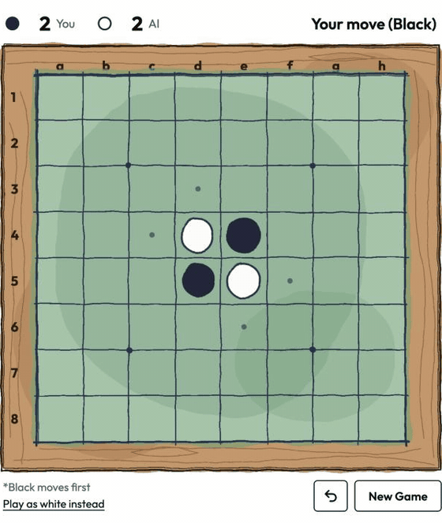

# Othello on the Fly

This is a C++ Othello (aka Reversi) engine aimed at strong play and fast search. It uses **negamax** with **alpha–beta pruning**, a **transposition table** (Zobrist hashing), **thread-pool** root parallelism, and an **n-tuple neural network** evaluator.

Try out the game on web: <a href="https://nguyen-trinhtk.github.io/othello-on-the-fly" target="_blank" rel="noopener noreferrer"><strong>Othello on the Fly</strong></a>

This is how a gameplay can look like (timelapsed). 

<p align="center">
  
</p>

(Thanks Claude for helping with the GIF.)

For more about the game, please see this [rulebook by World Othello Foundation](https://www.worldothello.org/about/about-othello/othello-rules/official-rules/english).

## Implementation

**Search**
- **Negamax**: finds a move recursivelee assuming both sides play optimally
- **Alpha–beta pruning**: skips irrelevant branches in search tree that cannot beat the best move found so far
- **Transposition table + Zobrist hashing**: caches scores for positions already seen
- **Thread pool**: searches root moves in parallel (got about **5–6×** faster on 8 cores)

**Evaluation**

As you can see from the above GIF, a greedy approach based on disc counts does not always work. Play strategies also depend on the location of the discs played; usually, this also means some sort of "fortune-telling" of the board state. Nevertheless, there exist good evaluation methods that let the engine stay strong without searching as deeply.

A dynamic-learning approach is very relevant here. This repo implements an N-tuple network ([Jaskowski 2014](https://arxiv.org/pdf/1406.1509)), a lightweight approach with only 256 weights for faster inference. Heavier alternatives are present in more complex CNNs (e.g. [Liskowski et al.](https://arxiv.org/abs/1711.06583)).

The network is trained via two-step reinforcement learning (RL): first against heuristics, then using Temporal Difference (TD) learning. It is trained in PyTorch and then loaded by the C++ engine.
## Repo structure

```
app/           main app
web/           web version of the game (HTML, CSS, JavaScript)
wasm/          builds the engine for the web (./wasm/build.sh, needs Emscripten)
src/ include/  search, eval, board rules (C++)
python/        n-tuple training (PyTorch)
benchmarks/    speed and strength tests
docs/          notes and stats
```
